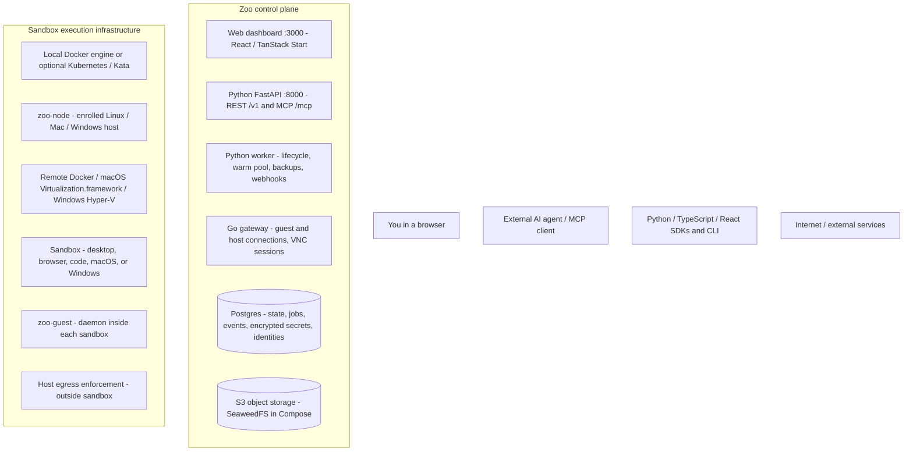
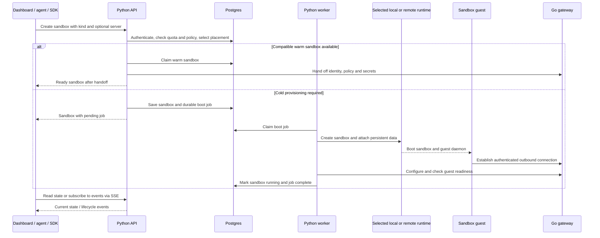

# Zoo component, API, tool, and security map

For a simple list of component names and their uses, see [Zoo components](components.mmd).

This map describes the current checkout, including optional runtime paths. It is a code walkthrough, not a verification of a running installation or a security audit. Solid arrows show calls or connections; dotted arrows show configuration or optional integrations. Replies travel back over the same connection.

Zoo supplies computers and tools to external AI agents. The model, planner, and decision loop live in the external client.

## 1. Main components

The API and worker share Python code but run as separate services in Compose. Postgres is also the durable job store; there is no separate Redis or message broker in this deployment. API requests can perform runtime work too, including claiming a warm sandbox and applying configuration; cold lifecycle work runs in the worker.

Optional Caddy terminates HTTPS on ports 80/443: `/api/*` goes to the Python API with `/api` removed, `/api/guest/connect` goes directly to gateway port 8001, and other traffic goes to the web service. Node mTLS uses its separate port 7443. Optional OpenTelemetry export feeds Grafana/LGTM. The `apps/site/` Astro application serves the marketing site and documentation, separately from the dashboard.

## 2. What happens when an agent calls a tool

```mermaid
flowchart LR
    caller["MCP client or REST / SDK caller"]
    entry["MCP tool wrapper or REST tool endpoint"]
    auth["Authenticate user / API key and workspace"]
    checks["Check membership, sandbox access, permission, kind, arguments"]
    registry["Shared tool registry - select platform implementation"]
    gateway["Go gateway"]
    guest["zoo-guest"]
    shellFiles["Shell, files, terminal, accessibility, windows and apps"]
    vnc["Gateway-owned VNC session"]
    linuxTransport["Linux: tunnel through guest to VNC"]
    nativeTransport["Mac / Windows: node tunnel and pinned SSH to VNC"]
    display["Sandbox screen and input"]
    record["Record execution and redact secret values in tool results"]

    caller --> entry --> auth --> checks --> registry
    registry -->|"Shell / files / OS operations"| gateway
    gateway -->|"GuestCall / GuestStream"| guest
    guest --> shellFiles
    registry -->|"Screenshot / mouse / keyboard RPCs"| vnc
    vnc --> linuxTransport --> display
    vnc --> nativeTransport --> display
    shellFiles --> record
    display --> record
    record --> result["Return result to caller"]
```

The VNC session belongs to the gateway. The dashboard viewer also reaches it through the API's WebSocket relay. The terminal uses the guest's PTY service. A required guest disconnect fails guest-dependent tools; Zoo does not silently switch them to runtime exec. Code sandboxes have no screen. Tool-result redaction does not prevent a permitted command or screenshot from exposing sensitive data inside the sandbox.

| Tool group | Registered tools | Permission |
| --- | --- | --- |
| Observe | `screenshot`, `screen_diff`, `wait_until_stable`, `accessibility_tree` | `screen.read` |
| Mouse | `click`, `double_click`, `move_mouse`, `scroll`, `drag` | `input.control` |
| Keyboard | `type_text`, `press_key`, `hotkey` | `input.control` |
| Windows | `windows_list`; `window_focus`, `window_minimize`, `window_restore`, `window_maximize`, `window_unmaximize`, `window_close` | List: `screen.read`; changes: `input.control` |
| Apps | `installed_apps`, `open_app`, `close_app` | List: `screen.read`; changes: `input.control` |
| Browser / web | `open_url`, `fetch_url` | Open: `input.control`; fetch: `shell.exec` |
| Shell | `execute_command` | `shell.exec` |
| File reads | `list_files`, `get_file_info`, `read_file` | `files.read` |
| File changes | `write_file`, `create_directory`, `delete_file`, `move_file`, `copy_file` | `files.write` |

MCP additionally exposes `list_sandboxes`, `create_sandbox`, and `get_sandbox`. Browser sandboxes allow observe, mouse, keyboard, windows, and browser categories; code sandboxes allow shell, files, and web categories. Desktop/native kinds do not have that category restriction, but still require authorization and platform support.

## 3. Creating a sandbox

Docker homes stay on the selected engine; Kubernetes homes use node-local storage. Object storage supports export/restore and profiles rather than automatically making homes portable. Docker stop initially freezes the container; Kubernetes lifecycle stop/resume uses VM-control. Separately, Kubernetes warm-pool pause/resume helpers use guest process signals rather than whole-VM pause. Later cleanup can remove compute while retaining home storage. Native VM saved states have platform and identity constraints.

## 4. API map

Paths below are relative to the Python API. With the domain/Caddy setup, prepend `/api` at the public URL.

| Surface | Representative paths | Purpose |
| --- | --- | --- |
| REST authentication | `/v1/auth/signup`, `/v1/auth/login`, `/v1/auth/me`, `/v1/api-keys` | Accounts, JWT login, API keys |
| Workspaces | `/v1/workspaces`, member/quota/invitation routes | Team membership and resource limits |
| Sandbox lifecycle | `/v1/sandboxes`, `/v1/sandboxes/{id}/start`, `/stop`, `/lifecycle`, `/move`, `/upgrade` | Create, inspect, change, delete, and schedule lifecycle work |
| Tools | `GET /v1/tools`, `POST /v1/sandboxes/{id}/tools/{name}` | Discover tools and execute them |
| Convenient operations | `/v1/sandboxes/{id}/exec`, `/exec/stream`, `/screenshot`, `/files/content` | Commands, streamed output, screenshots, uploads/downloads |
| Desktop / terminal | `/v1/sandboxes/{id}/vnc-ticket`, `/ws`, `/terminal-ticket`, `/terminal` | Ticket issuance and WebSocket connections |
| Sharing | `/v1/sandboxes/{id}/viewer-links`, `/embed/{token}`, `/v1/embed/{token}/ws` | Expiring embedded viewer/control links |
| Policies / secrets | Sandbox `/permissions`, `/network`, `/network/rules`, `/apps`, `/secrets`; `/v1/vault/secrets` | Tool permissions, network/app rules, secrets |
| Hosts / capacity | `/v1/servers`, `/v1/platforms`, `/v1/nodes/tokens`, `/v1/nodes/join`, `/v1/kubernetes`, `/v1/pool` | Enrollment, host status, runtime capability, warm pool |
| Persistence | Sandbox `/snapshots`, `/backup`, `/restore`; `/v1/profiles` | Snapshots, portable app profiles, backup/restore |
| Events / operations | `/v1/events`, `/v1/events/stream`, `/v1/webhooks`, `/v1/audit-logs`, `/v1/usage`, `/v1/monitoring`, `/v1/admin/*` | Lifecycle events, webhooks, audit, usage, administration |
| MCP | `/mcp/` | The shared tools plus sandbox create/list/get |
| Gateway internal | TLS gRPC `:7444`; peer TLS HTTP `:8002`; guest WebSocket `:8001/guest/connect` | Private tool/stream RPC, replica relay, guest connection ingress |
| Host transport | mTLS gRPC `:7443` | Outbound enrolled-node streams and tunneled host access |

## 5. Security considerations per component

“Implemented boundary” describes code/configuration intent. “Considerations” identifies what deployment operators must protect or verify; it is not a claim that those checks passed in this installation.

| Component | Implemented boundary | Security considerations |
| --- | --- | --- |
| External agent / MCP client / SDK / CLI | Bearer credential and workspace scope; server checks each operation | Grant only needed tools and sandboxes. Treat agent instructions and sandbox content as untrusted. A key permitting shell execution permits arbitrary commands inside its sandbox. Keep credentials out of prompts, repository files, and logs. |
| Web dashboard | Calls authenticated API; desktop/terminal use tickets; browser token stored in local storage | XSS or a hostile browser extension can steal the token. Review rendered untrusted content and dependencies. Use HTTPS and restrict CORS origins. UI visibility alone is not authorization. |
| Caddy / public ingress | TLS termination; distinct API and guest routes; domain validation callback | Expose only intended paths. Keep proxy forwarding trust accurate. Guest connections route to the gateway rather than the API. Node port 7443 needs its own reachable TLS transport. |
| Python API and MCP adapter | Shared authorization and tool dispatch; workspace membership, key scope, sandbox policy, kind restrictions | Both surfaces must enforce the same rules. Protect JWT and wrapping keys. API processes have Docker socket access in Compose, so API compromise can become host compromise. Restrict access and apply deployment resource limits. |
| Tool registry and platform implementations | Explicit permission/action per tool; argument checks and platform dispatch | Adding a tool changes the security surface. Verify permission mapping and command/path handling for each OS. File and shell permissions can reveal secrets; app restrictions do not make unrestricted shell execution safe. |
| Python worker | Durable jobs and leases; privileged provisioning and policy application | Treat it as a privileged controller. Protect runtime sockets, host identities, backup credentials, and job state. Verify retries, warm handoff, and restored sandboxes preserve the intended identity and policy. |
| Go gateway | Authenticated TLS RPC, separate mTLS host stream, authenticated guest connections, DB-based placement; owns VNC sessions | Keep private 7444/8002 listeners private; expose only guest routing from 8001. The gateway can access sensitive host/VNC credentials. Review guest identity, node revocation, replica routing, and stream limits under failure. |
| zoo-node / host SSH account | Single-use short-lived enrollment token, node CA and mTLS, pinned SSH host key, outbound tunnel | Protect join tokens and node keys. The enrolled account's Docker/hypervisor privileges cross sandbox boundaries. Keep Docker TCP closed and remove obsolete host enrollment. Host compromise compromises sandboxes placed there. |
| zoo-guest | Authenticated outbound connection and advertised OS services; required for guest-dependent operations | Keep its credentials tied to the correct sandbox, especially after cloning/restoring. Run agent workloads with the intended guest user. An authorized shell caller can access that user's data; guest admin/root changes the threat model. |
| Linux Docker / Kata runtime | Docker config drops `NET_RAW` and sets no-new-privileges; isolation selects ordinary containers or Kata VMs | Ordinary Docker shares the engine kernel. Require and verify Kata where a VM boundary is needed. Never expose runtime sockets or host mounts inside untrusted workloads. Protect engine access and persistent home volumes. |
| Kubernetes / CSI / VM-control | Kata execution, node-local volumes, network policy; separate VM-control TLS frontend and privileged broker | Protect Kubernetes/CSI credentials and runtime sockets. VM-control must use its own allowed controller identities and pinned node identity. Confirm compatible CNI, shim, and actual pause/resume behavior on the target platform. |
| macOS VM / Windows VM and helpers | Native virtualization boundary; host helper access through authenticated node transport | Protect base images, disks, saved states, host helper account, and host VNC transport. Reused images/states must receive the correct sandbox identity and secrets. Guest admin access can alter guest-local controls. |
| Desktop viewer / VNC / terminal | API tickets; viewer links have view/control scope and expiry; allowed embed origins; gateway enforces view-only input limits | Treat viewer URLs/tickets as access credentials. Do not expose raw VNC publicly. Verify expiration and revocation of active connections. View-only still reveals screen content; terminal access allows permitted commands. |
| Host egress daemon | Network enforcement outside Linux sandbox; host policy for native VMs; Linux daemon needs root/`NET_ADMIN` | Protect policy files and daemon access. Check DNS, direct-IP, IPv6, proxy bypass, and private-network access in the real deployment. Kubernetes requires matching namespace/CNI controls. Guest-local firewalls alone are insufficient against guest admin. |
| Postgres | Authoritative tenancy, jobs, events, node CA, host identities, encrypted secret material | Restrict connectivity and credentials; Compose publishes loopback 5432. Database modification can change authorization and placement. Protect backups plus the wrapping keys required to decrypt restored material. |
| Vault / encryption / optional KMS | Per-workspace data keys and encrypted values; tool results redact known secret values | Protect current/previous wrapping keys and KMS authorization. Secret injection makes values available to permitted guest processes. Redaction cannot stop screen disclosure, transformed values, or authorized exfiltration. |
| SeaweedFS / S3 / backup and profile objects | S3 credentials and application-level ownership checks | Compose supplies development credentials: replace them for shared deployments. Keep storage private; backups/profiles may contain credentials and user files. Verify retention, restore authorization, and encryption requirements. |
| Events / webhooks / audit / telemetry | Workspace-scoped API records; webhook delivery and private-target restrictions; optional OTLP export | Treat webhook destinations as outbound requests requiring SSRF controls. Keep private-target overrides deliberate. Audit/log/trace systems can contain command arguments and sensitive metadata; restrict access and retention. |
| Documentation site / built images | Separate Astro site; installer and build images supply executable code | Keep the public docs service separate from privileged control credentials. Pin and review deployment artifacts and base images; protect release credentials. Documentation claims do not establish deployed isolation. |

## 6. Source guide

| Area | Source |
| --- | --- |
| Deployment and ingress | [`compose.yml`](../compose.yml), [`Caddyfile`](../Caddyfile) |
| API assembly and background tasks | [`server/server.py`](../apps/server/server.py) |
| MCP and shared registry | [`server/mcp.py`](../apps/server/mcp.py), [`server/registry.py`](../apps/server/registry.py) |
| Sandbox lifecycle and tool authorization | [`server/sandbox_api.py`](../apps/server/sandbox_api.py), [`server/jobs.py`](../apps/server/jobs.py) |
| Runtime routing | [`server/runtime.py`](../apps/server/runtime.py), [`server/remote_docker.py`](../apps/server/remote_docker.py) |
| Gateway protocols and VNC transport | [`go/gateway/proto/gateway.proto`](../go/gateway/proto/gateway.proto), [`go/gateway/vnc_target.go`](../go/gateway/vnc_target.go), [`go/node/proto/node.proto`](../go/node/proto/node.proto) |
| Guest services | [`go/guest/main.go`](../go/guest/main.go) |
| Dashboard API client | [`web/src/lib/api_client.ts`](../apps/web/src/lib/api_client.ts) |
| Existing architecture and security model | [`Architecture`](../apps/site/src/content/docs/docs/concepts/architecture.md), [`Security model`](../apps/site/src/content/docs/docs/concepts/security-model.md), [`VM-control`](../go/vm-control/README.md) |
